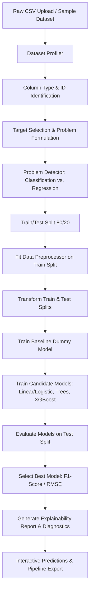

Live Demo: https://autonomous-ml-pipeline-builder.onrender.com/

# Autonomous ML Pipeline Builder

An end-to-end automated machine learning (AutoML) application built with Python, Scikit-learn, XGBoost, and Streamlit. The tool automates tabular data profiling, target validation, leak-free preprocessing, multi-model training, baseline benchmarking, performance evaluation, and interactive inference.

---

## Architecture & Application Flow



---

## Features

- **Automated Dataset Profiling**: Computes dimensions, column data types, missing value percentages, unique cardinalities, and duplicate counts.
- **ID Column Detection**: Flags potential identifier columns using high-cardinality heuristics and naming patterns, allowing them to be excluded from training.
- **Problem Type Detection**: Infers whether a target variable represents a Classification or Regression task with automated class imbalance checks.
- **Strict Data Leakage Prevention**: Enforces a strict order of operations: train/test splitting occurs first, and preprocessing transformers are fitted exclusively on training data.
- **Modular Preprocessing Pipelines**:
  - Numerical features: Median imputation + `StandardScaler`.
  - Categorical features: Most-frequent imputation + `OneHotEncoder(handle_unknown='ignore')`.
  - Implemented using Scikit-learn's `ColumnTransformer` and `Pipeline`.
- **Candidate Model Benchmarking**:
  - **Classification**: Dummy Classifier (Baseline), Logistic Regression, Decision Tree, Random Forest, XGBoost Classifier.
  - **Regression**: Dummy Regressor (Baseline), Linear Regression, Decision Tree Regressor, Random Forest Regressor, XGBoost Regressor.
- **Objective Model Selection**:
  - Automatically identifies the highest-performing model using F1-score (classification) or RMSE (regression).
  - Explicitly benchmarks every model against the Dummy baseline.
- **Model Explainability & Visualizations**:
  - Extracts and displays feature importances / normalized coefficient magnitudes.
  - Generates confusion matrix heatmaps for classification and actual-vs-predicted scatter plots for regression using Plotly.
  - Produces an automated pipeline summary log.
- **Interactive Inference & Export**:
  - Generates dynamic input widgets based on dataset features for real-time single-sample predictions.
  - Displays predicted class probabilities or regression values.
  - Serializes and exports the full trained pipeline bundle as `model.joblib`.

---

## Tech Stack

- **Python 3.11+**: Core programming language.
- **Streamlit**: Web application interface.
- **Scikit-learn**: Machine learning algorithms, transformers, preprocessing pipelines, and evaluation metrics.
- **XGBoost**: Gradient-boosted decision trees for tabular data.
- **Pandas & NumPy**: Data loading, profiling, and array manipulations.
- **Plotly**: Interactive data visualizations and diagnostic charts.
- **Joblib**: Model serialization and persistence.
- **Pytest**: Automated test suite for data profiling, problem detection, and pipeline execution.

---

## Project Structure

```text
autonomous-ml-builder/
├── app.py                      # Streamlit web application
├── requirements.txt            # Python dependencies
├── README.md                   # Project documentation
├── .gitignore                  # Git ignore rules
│
├── src/                        # Modular pipeline components
│   ├── __init__.py             # Package exports
│   ├── data_profiler.py        # Dataset statistics and column identification
│   ├── problem_detector.py     # Problem type and class balance detection
│   ├── preprocessing.py        # Leak-free ColumnTransformer pipeline
│   ├── model_trainer.py        # Model training and baseline benchmarking
│   ├── evaluator.py            # Evaluation metrics (Accuracy, F1, RMSE, R²)
│   ├── model_selector.py       # Best model selection logic
│   ├── explainability.py       # Feature importance extraction and logging
│   └── predictor.py            # Inference runner and Joblib persistence
│
├── data/                       # Bundled sample datasets
│   ├── classification_sample.csv # Customer churn dataset
│   └── regression_sample.csv     # Real estate property pricing dataset
│
├── models/                     # Directory for exported joblib model bundles
│   └── .gitkeep
│
└── tests/                      # Automated test suite
    ├── __init__.py
    ├── test_profiler.py        # Profiler tests
    ├── test_detector.py        # Problem detector tests
    └── test_models.py          # End-to-end training and prediction tests
```

---

## Installation

1. Clone the repository:

   ```bash
   git clone https://github.com/username/autonomous-ml-builder.git
   cd autonomous-ml-builder
   ```

2. Create and activate a virtual environment:

   ```bash
   python3 -m venv venv
   source venv/bin/activate
   ```

   *On Windows:*
   ```bash
   venv\Scripts\activate
   ```

3. Install the dependencies:

   ```bash
   pip install -r requirements.txt
   ```

---

## Usage

1. Start the Streamlit application:

   ```bash
   streamlit run app.py
   ```

2. Open the application in your browser at `http://localhost:8501`.

3. Select a dataset source:
   - Use one of the pre-loaded sample datasets (Customer Churn or House Prices).
   - Or upload a custom CSV file.

4. Follow the step-by-step workflow across the tabs:
   - **Data Overview**: Inspect rows, data types, and initial records.
   - **Data Profiler**: Review missingness tables, column types, and distributions.
   - **Setup & Detection**: Confirm target column, problem type, and split ratio.
   - **Train & Compare**: Click **Start Automated ML Pipeline** to train all models.
   - **Best Model & Explain**: Review the winning model, feature importance rankings, and diagnostic plots.
   - **Predict & Export**: Input new feature values for real-time predictions, or download `model.joblib`.

---

## The ML Pipeline

```text
CSV Upload → Profiling → Problem Detection → Preprocessing → Model Training → Evaluation → Model Selection → Prediction
```

1. **CSV Upload**: Loads tabular data from user upload or sample datasets.
2. **Profiling**: Generates descriptive statistics, flags missing values, and identifies potential identifier columns.
3. **Problem Detection**: Checks the target variable's type and cardinality to identify Classification vs. Regression, auditing for class imbalance.
4. **Preprocessing**:
   - Performs `train_test_split(test_size=0.2, random_state=42)` prior to any data transformation.
   - Fits `ColumnTransformer` (median imputation + standard scaling for numerical columns; most-frequent imputation + one-hot encoding for categorical columns) exclusively on the training split.
   - Transforms test data using the fitted pipeline to prevent data leakage.
5. **Model Training**: Fits a dummy baseline model along with linear, tree-based, and gradient-boosted models.
6. **Evaluation**: Evaluates all models on unseen test data using task-appropriate metrics (Accuracy, Precision, Recall, F1 for classification; MAE, RMSE, R² for regression).
7. **Model Selection**: Selects the best-performing model based on test F1-score (classification) or test RMSE (regression).
8. **Prediction**: Uses the serialized pipeline to transform new raw inputs and output predictions with confidence scores.

---

## Running the Tests

To run the unit test suite:

```bash
pytest tests/ -v
```

All 9 test cases cover:
- Column type and identifier detection
- Missing value analysis
- Problem type inference (classification vs. regression)
- Target validation
- End-to-end classification pipeline (fit, evaluate, predict)
- End-to-end regression pipeline (fit, evaluate, predict)

---

## Future Improvements

- **Hyperparameter Optimization**: Add Bayesian optimization via Optuna.
- **Advanced Explainability**: Integrate SHAP (SHapley Additive exPlanations) for local sample explanations.
- **API Serving**: Expose the trained `model.joblib` bundle via a FastAPI service.
- **Containerization**: Provide a Dockerfile for reproducible containerized deployments.
- **Experiment Lineage**: Add MLflow tracking for logging model runs and parameters.
